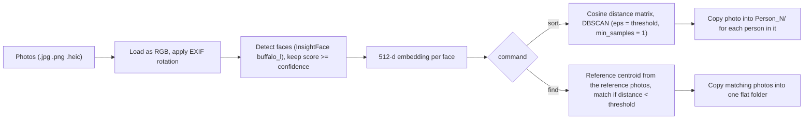

# Face Sorter & Finder

Group a messy photo folder by person, or pull out every photo of one specific person, using InsightFace face embeddings. Runs locally on CPU.

[](https://github.com/adityam789/image_face_detection/actions/workflows/ci.yml)

[](LICENSE)

## What it does

| Command | Input | Result |
| --- | --- | --- |
| `facesorter sort` | A folder of photos | Copies each photo into `Person_N/` folders, one per distinct face cluster, plus a `report.txt` |
| `facesorter find` | A folder of reference photos of one person and a folder to search | Copies every photo in which that person appears into one output folder |

Supported inputs: `.jpg`, `.jpeg`, `.png` and `.heic` (any letter case), found recursively. EXIF orientation is applied before detection, so sideways phone photos work.

## How it works



1. **Load.** Pillow and `pillow-heif` open the file; the EXIF orientation is applied and the image is converted to RGB.
2. **Detect and embed.** InsightFace's `buffalo_l` model pack finds faces and produces a 512-dimensional embedding for each. Faces scoring below `--confidence` are ignored.
3. **Compare.** Faces are compared by cosine distance, `1 - cosine similarity`.
4. **Group or match.**
   - `sort` clusters all embeddings with DBSCAN on the precomputed distance matrix.
   - `find` averages the embeddings of the reference photos (the largest face in each) into one unit-length centroid and keeps any photo that has a face closer to it than the threshold.
5. **Copy.** Originals are copied, never moved.

More detail is in [docs/architecture.md](docs/architecture.md).

## Installation

Requires Python 3.9 or newer.

```bash
git clone https://github.com/adityam789/image_face_detection.git
cd image_face_detection
python -m venv .venv
source .venv/bin/activate      # Windows: .venv\Scripts\activate
pip install -e .
```

On the first real run InsightFace downloads the `buffalo_l` model pack (a few hundred MB) into `~/.insightface/models/`. After that the tool does not need a network connection. Inference runs on the CPU (ONNX Runtime `CPUExecutionProvider`); there is no GPU option in the CLI.

`pip install -e .` pulls the newest `insightface`, which is published as a wheel, so no compiler is needed. Only the old 0.7.x releases are source-only and need a C/C++ compiler.

`requirements.txt` lists the same runtime dependencies for people who prefer `pip install -r requirements.txt`; `pyproject.toml` is the source of truth.

## Quick start

```bash
# Group photos by person
facesorter sort --source ./my_photos --output ./sorted_results

# Find every photo of one person, given a few clear photos of them
facesorter find \
    --reference ./reference_photos/bob \
    --source ./all_photos \
    --output ./found_bob
```

`python -m facesorter ...` and `python face_sorter.py ...` are equivalent to the `facesorter` command. Use a fresh output directory for each run (see [Behavior to know about](#behavior-to-know-about)).

### Example `sort` output

Layout (illustrative file names):

```text
sorted_results/
  Person_0/
    IMG_0001.jpg
    IMG_0007.jpg
  Person_1/
    IMG_0002.jpg
    IMG_0007.jpg      <- a photo of two people is copied into both folders
  report.txt          <- summary and per-file lists
  processing_log.txt  <- the run's log output
```

Example `report.txt` produced by running the pipeline with a stand-in face model on synthetic images (the numbers below are from that toy run, not from real photos):

```text
Face Sorting Report
========================================
Total images processed: 7
Total faces detected: 6
Unique persons found: 3
Images with multiple faces: 1
Images with no faces: 1
Images failed to load: 1
Images failed during face detection: 0
Files copied: 6 of 6
Copy failures: 0

Images with no faces:
photos/img_005.jpg

Images failed to load:
photos/broken.jpg

Images failed during face detection:

Images with multiple faces:
photos/trip/img_001.jpg
```

`find` writes the matching photos straight into the output directory (no subfolders) and no `report.txt`; its summary line is in `processing_log.txt`.

## Command reference

Global options (before the subcommand): `--version`, `-h/--help`, `-v/--verbose`.

### `facesorter sort`

| Option | Required | Default | Description |
| --- | --- | --- | --- |
| `--source DIR` | yes | | Directory of images, searched recursively |
| `--output DIR` | yes | | Directory to write `Person_N/` folders, `report.txt` and `processing_log.txt` into |
| `--threshold FLOAT` | no | `0.6` | Cosine distance within which faces are chained into the same group (`<=`). Range 0.0 to 2.0 |
| `--confidence FLOAT` | no | `0.8` | Minimum face detection score. Range 0.0 to 1.0 |
| `--config FILE` | no | `./config.ini` if present | Config file to read |
| `-v`, `--verbose` | no | off | Debug logging (also accepted before the subcommand) |

### `facesorter find`

| Option | Required | Default | Description |
| --- | --- | --- | --- |
| `--source DIR` | yes | | Directory to search, recursively |
| `--reference DIR` | yes | | Directory of clear photos of the target person |
| `--output DIR` | yes | | Directory the matching photos are copied into |
| `--threshold FLOAT` | no | `0.6` | A face matches when its distance to the reference is strictly less than this. Range 0.0 to 2.0 |
| `--confidence FLOAT` | no | `0.8` | Minimum face detection score, applied to reference and searched photos. Range 0.0 to 1.0 |
| `--config FILE` | no | `./config.ini` if present | Config file to read |
| `-v`, `--verbose` | no | off | Debug logging |

### Configuration file

Settings can live in an INI file's `[DEFAULT]` section. Precedence, highest first: command-line flags, config file, built-in defaults.

```ini
[DEFAULT]
# minimum detection score, 0.0 - 1.0
confidence = 0.8
# used by `sort`, 0.0 - 2.0
cluster_threshold = 0.6
# used by `find`, 0.0 - 2.0; falls back to cluster_threshold if omitted
match_threshold = 0.6
```

Put comments on their own lines; a trailing `# ...` after a value is read as part of the value and rejected.

`--threshold` sets `cluster_threshold` for `sort` and `match_threshold` for `find`. The default config file is looked up relative to the current working directory, so run from the repository root or pass `--config /path/to/config.ini`. A missing implicit `./config.ini` is fine; a missing file named with `--config`, an unparsable file, or an out-of-range or non-numeric value is an error (exit code 2). Unknown keys are ignored.

### Exit codes

| Code | Meaning |
| --- | --- |
| `0` | Success (including a `find` run that matches nothing) |
| `1` | The run failed: no images found, no faces found (for `find`, in the reference photos), every copy failed, or an unexpected error |
| `2` | Bad arguments, missing or overlapping directories, or invalid configuration |
| `130` | Interrupted (Ctrl+C) |

## Tuning the threshold

Thresholds are cosine distances between embeddings: 0 means identical direction, 1 unrelated, 2 opposite. The useful cut-off depends on your photos (lighting, age gaps, angles, image quality). The default of 0.6 is a starting point, not a calibrated value; this project does not include accuracy benchmarks.

| Symptom | Try |
| --- | --- |
| Different people share a folder | Lower `--threshold` (for example `0.4` or `0.5`) |
| One person is split across several folders | Raise `--threshold` (for example `0.7`), noting that grouping chains (see below) |
| `find` returns other people | Lower `--threshold`; give it more, clearer reference photos |
| `find` misses photos of the person | Raise `--threshold` slightly, or add reference photos in varied conditions |
| "No faces" for photos that clearly have faces | Lower `--confidence` (for example `0.5`); for `sort` the log shows the best score found in each rejected photo |

## Behavior to know about

- **Originals are never touched.** Files are copied; sources are not moved or deleted.
- **Existing files are never overwritten.** If the destination name is taken, the copy gets a `_1`, `_2`, ... suffix (`photo.jpg` becomes `photo_1.jpg`). Photos from different subfolders that share a file name are kept the same way. A rerun into the same output directory therefore creates duplicate suffixed copies, so use a fresh output directory per run. `report.txt` and `processing_log.txt` are rewritten on every run.
- **A photo with several people is copied into each person's folder** (`sort`).
- **Output inside the source folder is allowed** and skipped when scanning, so earlier results are not re-read. A source (or reference) folder that is the output folder, or lies inside it, is rejected with exit code 2 before anything is created.
- **Folder numbering is not meaningful.** `Person_N` is the cluster label; the numbers carry no ranking, and folders are not named after anyone.
- **Faces below `--confidence` are ignored**, so a photo whose only faces score low ends up in no folder and is listed under "Images with no faces".
- One unreadable or failing image is logged and skipped; it does not abort the run.

## Design decisions and trade-offs

- **DBSCAN with `min_samples=1`.** Every face is a core point, so there is no noise label and every face lands in some group; the only parameter is the distance threshold. The price is single-linkage chaining: if A is near B and B is near C, all three are grouped even when A and C are far apart. One ambiguous face (blurry, profile, a look-alike) can bridge two people and merge them. A lower threshold reduces this but splits people more. A larger `min_samples` or a centroid-based method would be stricter; the rationale is documented in [`facesorter/clustering.py`](facesorter/clustering.py).
- **Dense pairwise distance matrix.** `sort` builds an N x N matrix over all detected faces, so memory grows as O(N^2) (one float per pair of faces, plus temporary copies). That is fine for a family photo library and a poor fit for tens of thousands of faces. This is a known limitation. A future version could avoid materialising the full matrix with chunked distance computation or approximate nearest-neighbour search.
- **Reference centroid from unit-normalised embeddings.** In `find`, each reference photo contributes its largest face, every embedding is normalised to unit length before averaging so no photo dominates through embedding magnitude, and the centroid is normalised again because cosine distance is direction-only.
- **Lazy imports.** `import facesorter`, `--help` and `--version` do not load scikit-learn or InsightFace, so the CLI starts quickly, and importing the modules does not require model weights.
- **Fake-model testing.** The detection step only needs an object with `get(img_bgr)` returning faces with `bbox`, `embedding` and `det_score`. Pipeline code accepts such a model through a `model=` parameter, so tests run the sort and find logic on synthetic data without downloading weights.
- **Typed errors map to exit codes.** Expected failures are `FaceSorterError` subclasses (`ConfigError`, `InvalidPathError`, `NoImagesError`, `NoFacesError`, `CopyError`); the CLI turns them into one-line messages and the exit codes above instead of tracebacks (use `-v` for the traceback on unexpected errors).
- **Deterministic output.** Files are discovered in sorted order, `Person_N` folders are ordered by cluster label, and name collisions are resolved in a fixed order, so the same inputs and settings give the same folder layout (assuming the model yields the same embeddings).

## Limitations

- Not benchmarked: there are no accuracy or speed numbers here, and results depend heavily on photo quality. Expect mistakes, especially for children, large age gaps, masks, sunglasses and low-resolution faces, and review the output.
- Chaining and the O(N^2) memory use described above.
- CPU only; large libraries are slow. Each image is fully decoded and run through the model, and InsightFace's `buffalo_l` pack also bundles landmark and gender/age models that this tool does not use.
- `.heif` and other formats are not scanned; only `.jpg`, `.jpeg`, `.png`, `.heic`.
- `sort` has no incremental mode: every run reclusters everything.

## Privacy and licensing

This tool does face recognition on photos that usually contain other people. Only run it on photos you have the right to process, and get consent where appropriate (laws on biometric data vary by region). Processing is local: the code in this repository makes no network requests; the only network access is InsightFace's one-time download of the model weights. Output folders contain copies of your photos, so protect them accordingly.

The InsightFace Python library is MIT licensed, but its README states that the pretrained models it provides (including the auto-downloaded `buffalo_l` pack) are available for non-commercial research purposes only. Check InsightFace's current license terms before any commercial use. This project's own code is MIT licensed, see [LICENSE](LICENSE).

## Troubleshooting

- **No faces found?** Lower `--confidence` (for example to `0.5`) to detect smaller or blurrier faces.
- **Mixed people in one folder?** Lower `--threshold` (for example to `0.4`) to make the grouping stricter.
- **Same person split across folders?** Raise `--threshold` (for example to `0.7`).
- **`Config file not found` or `must be between ...`?** Check `--config` and the values in your INI file; exit code 2 means the input was rejected before any work started.
- **Failed to install `insightface`?** This only happens with old 0.7.x pins, which build from source; upgrade (`pip install -U insightface`) or install a C/C++ compiler (Xcode command line tools on macOS, `build-essential` on Debian/Ubuntu) and retry.
- **macOS: `ImportError` mentioning `__thread_bss` when importing scipy.** Seen on macOS 27 (beta) with Python 3.10 and scipy 1.15.x wheels. Use Python 3.11 or newer, or `pip install "scipy<1.15"`. `facesorter --help` still works because heavy imports are deferred.

## Development

```bash
pip install -e ".[dev]"
ruff check .
ruff format --check .
pytest
```

Layout:

```text
facesorter/
  __init__.py      version, lazy public API (process_images, find_matches)
  __main__.py      python -m facesorter
  cli.py           argument parsing, logging setup, exit codes
  config.py        settings resolution and validation (CLI > config > defaults)
  detection.py     InsightFace model loading, Face dataclass
  clustering.py    cosine-distance DBSCAN
  pipeline.py      sort: scan, cluster, copy, report
  finder.py        find: reference centroid, matching, copy
  utils.py         image loading, file discovery, safe copying
  paths.py         path comparison helpers
  errors.py        typed exceptions
tests/             pytest suite using a fake face model (no model weights needed)
scripts/
  visualize_detections.py   draw detected boxes and scores on one image (debug aid)
docs/
  architecture.md
.github/workflows/ci.yml    CI: lint, format check, tests
face_sorter.py     thin wrapper around facesorter.cli.main
config.ini         example settings
pyproject.toml     packaging and tool config; source of truth for dependencies
requirements.txt   mirror of the runtime dependencies
LICENSE
CHANGELOG.md
CONTRIBUTING.md
```

`scripts/visualize_detections.py --image PHOTO --confidence 0.6 --output out.jpg` is a debugging aid that draws detection boxes and scores on an image. Its output contains the faces from the photo you give it, so keep it out of version control (the `.gitignore` already excludes `detections.jpg`).

GitHub Actions ([`.github/workflows/ci.yml`](.github/workflows/ci.yml)) runs on pushes to `main` and on pull requests, across Python 3.9 to 3.13 on Ubuntu: `pip install -e ".[dev]"`, `ruff check .`, `ruff format --check .`, and `pytest` with coverage for the `facesorter` package. Contribution notes are in [CONTRIBUTING.md](CONTRIBUTING.md); release notes are in [CHANGELOG.md](CHANGELOG.md).

## License

MIT, see [LICENSE](LICENSE).
