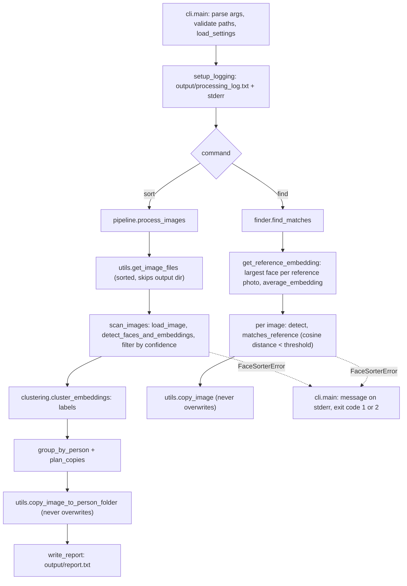

# Architecture

This page describes how the `facesorter` package is organised, how data moves through it, and how to test it without model weights. For usage see the [README](../README.md).

## Modules

| Module | Responsibility |
| --- | --- |
| `facesorter/__init__.py` | Defines `__version__`. Exposes `process_images` and `find_matches` lazily (PEP 562 `__getattr__`) so `import facesorter` stays cheap. Installs a `NullHandler` on the `facesorter` logger. |
| `facesorter/__main__.py` | Entry point for `python -m facesorter`. |
| `facesorter/cli.py` | `argparse` parser (`sort` and `find` subcommands), early path validation, settings resolution, per-run log file (`<output>/processing_log.txt`) and stderr logging, and the mapping from exceptions to exit codes. Imports the pipeline modules only when a command runs. |
| `facesorter/config.py` | `Settings` dataclass and `load_settings`: merges built-in defaults, the `[DEFAULT]` section of an INI file, and CLI overrides (highest priority), validating ranges (`confidence` 0 to 1, thresholds 0 to 2). |
| `facesorter/detection.py` | `get_face_model` (builds InsightFace `FaceAnalysis`, `buffalo_l`, CPU provider by default), the `Face` dataclass (`box`, `embedding`, `score`, `area`) and `detect_faces_and_embeddings`, which converts a PIL image to BGR and wraps the model's output. |
| `facesorter/clustering.py` | `cluster_embeddings`: dense cosine-distance matrix, then DBSCAN with `eps=threshold`, `min_samples=1`. See the module docstring for the chaining trade-off. |
| `facesorter/pipeline.py` | The `sort` workflow: `scan_images` (load, detect, confidence filter, collect per-file problems into a `ScanResult`), `group_by_person`, `plan_copies` (collision-free destination names), `write_report`, and the orchestrating `process_images`. |
| `facesorter/finder.py` | The `find` workflow: `get_reference_embedding` (largest face per reference photo, then `average_embedding`), `cosine_distances`, `matches_reference`, and the orchestrating `find_matches`. |
| `facesorter/utils.py` | `load_image` (EXIF transpose, RGB, HEIC via `pillow-heif`), `get_image_files` (recursive, sorted, skips the output directory), `unique_filename`, and `copy_image`, which opens the destination exclusively so it never overwrites. |
| `facesorter/paths.py` | `same_path` and `is_inside`, dependency-free helpers for detecting overlapping source and output directories (symlink- and case-insensitive-filesystem aware). |
| `facesorter/errors.py` | `FaceSorterError` and subclasses: `ConfigError`, `InvalidPathError`, `NoImagesError`, `NoFacesError`, `CopyError`. |
| `face_sorter.py` | Thin wrapper that calls `facesorter.cli.main`, kept for `python face_sorter.py ...`. |
| `scripts/visualize_detections.py` | Standalone debugging aid that draws boxes and scores on one image. Not part of the package. |

## Data flow



Per-file problems (an unreadable image, a model failure on one file, a failed copy) are logged and counted, and the run continues. Only whole-run problems raise a `FaceSorterError`: no images, no faces, every copy failed, or invalid paths and configuration.

## Design notes

- **Where side effects happen.** Path validation in `cli._check_paths` runs before anything is created. After it passes, `main` creates the output directory and opens the log file, then runs the command. `get_image_files` repeats the overlap check so the library functions are safe when called directly.
- **Error to exit code mapping.** `InvalidPathError` and `ConfigError` (and bad arguments) give exit code 2. Other `FaceSorterError`s and unexpected exceptions give 1. Ctrl+C gives 130. Expected errors print a single line; unexpected ones include a traceback only with `-v`.
- **Distance conventions.** `sort` joins faces at distance `<=` the threshold (DBSCAN's `eps`), while `find` requires distance strictly `<` the threshold. Cosine distance is clipped to a non-negative range.
- **Determinism.** Inputs are walked in sorted order, `Person_N` folders are ordered by label, images within a person keep first-seen order, and `unique_filename` resolves collisions in call order.
- **Known scaling limit.** `cluster_embeddings` builds a full N x N matrix over all kept faces. See the README's design section.

## Testing with a fake model

The detection layer only requires a model object with a `get` method:

```python
model.get(img_bgr)  # -> iterable of objects with .bbox, .embedding, .det_score
```

- `img_bgr` is a contiguous `numpy` array of shape `(H, W, 3)` in BGR order, as InsightFace expects.
- `.bbox` is a sequence of four numbers `(x1, y1, x2, y2)`; they are converted to `int`.
- `.embedding` is a 1-D `numpy` array (the real model returns 512 floats; any fixed length works for tests).
- `.det_score` is a float in `[0, 1]`, compared against `--confidence`.

`process_images(..., model=...)` and `find_matches(..., model=...)` accept such an object, and so do `scan_images`, `get_reference_embedding` and `detect_faces_and_embeddings`. When `model` is omitted the real InsightFace model is loaded, which is the only place weights are needed. Tests therefore never download anything and run quickly.

A minimal example that sorts three synthetic images into two groups, using the image's top-left pixel colour to choose an identity:

```python
from types import SimpleNamespace

import numpy as np
from PIL import Image

from facesorter.pipeline import process_images


class FakeModel:
    """Returns one face per image; the embedding is chosen from the top-left pixel."""

    EMBEDDINGS = {
        (255, 0, 0): np.array([1.0, 0.0, 0.0]),
        (0, 0, 255): np.array([0.0, 0.0, 1.0]),
    }

    def get(self, img_bgr):
        b, g, r = (int(v) for v in img_bgr[0, 0])
        return [
            SimpleNamespace(
                bbox=np.array([0, 0, 8, 8]),
                embedding=self.EMBEDDINGS[(r, g, b)],
                det_score=0.99,
            )
        ]


def test_sort_groups_by_identity(tmp_path):
    src = tmp_path / "photos"
    src.mkdir()
    for name, colour in [("a.png", (255, 0, 0)), ("b.png", (255, 0, 0)), ("c.png", (0, 0, 255))]:
        Image.new("RGB", (16, 16), colour).save(src / name)  # lossless, so colours survive

    n_persons = process_images(
        str(src), str(tmp_path / "out"), cluster_threshold=0.5, confidence=0.8, model=FakeModel()
    )

    assert n_persons == 2
    assert (tmp_path / "out" / "report.txt").exists()
```

Use PNG for synthetic images whose pixel values matter, since JPEG compression shifts colours. To exercise the CLI end to end, monkeypatch `facesorter.pipeline.get_face_model` and `facesorter.finder.get_face_model` to return the fake and call `facesorter.cli.main([...])`, asserting on the returned exit code.

Run the test suite with `pytest`; see [CONTRIBUTING.md](../CONTRIBUTING.md).
