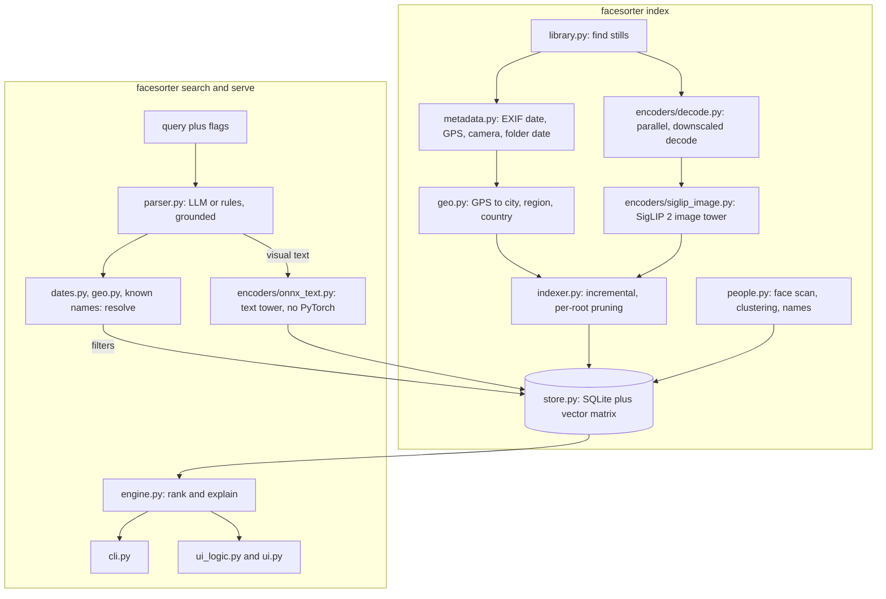
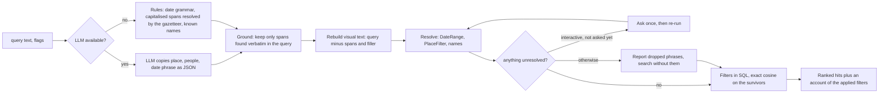

# Photo search: design

Natural-language search over a personal photo library. A query such as
`Bob at the beach last summer in Lisbon` is split into **structured filters** (date, place,
people) that are applied exactly, and **visual text** (`beach`) that is ranked with an image-text
embedding model. Everything runs locally. For usage see [search.md](search.md); for the package
layout in the context of the whole project see [architecture.md](architecture.md).

## Goals and non-goals

- A few thousand to about 100,000 still photos (HEIC, JPEG, PNG). Videos are out of scope.
- Works offline after one-time model downloads (SigLIP 2 and an optional small language model from
  the Hugging Face Hub; InsightFace's `buffalo_l` from GitHub the first time faces are scanned). No
  photo, embedding or query leaves the machine.
- Two front ends over one engine: a CLI and a local Gradio app.
- Query understanding by a small local LLM, by explicit flags, or by deterministic rules, so the
  feature degrades gracefully with no LLM installed.
- Non-goals: video, approximate (ANN) indexes, multi-user, cloud sync, non-English queries.

## Architecture

## Module map

| Module (`facesorter/search/`) | Responsibility |
| --- | --- |
| `types.py` | Shared frozen dataclasses and `Protocol`s (`PhotoMeta`, `Filters`, `SearchRequest`, `SearchResponse`, `ImageEncoder`, `TextEncoder`, `LLMBackend`, `Gazetteer`). The contract between modules |
| `errors.py` | Typed errors, subclasses of `facesorter.errors.FaceSorterError` (`IndexNotFoundError`, `IndexMismatchError`, `ModelUnavailableError`, `UnreadableImageError`) |
| `testing.py` | Fakes: colour-vocabulary image and text encoders, `ScriptedLLM`, `make_color_image`. No model runtime is imported |
| `library.py`, `metadata.py` | Find still images in a deterministic order (skipping hidden files, videos, symlinked folders); read EXIF date, GPS and camera without decoding pixels, and derive a month- or year-precision date from folder names |
| `geo.py` | Offline gazetteer on `geonamescache`: coordinate to `PlaceLabel`, name to `PlaceFilter`, ranked candidates for ambiguous names |
| `dates.py` | Date phrase to inclusive `DateRange`, with an explicit "understood?" signal and the grammar for what is refused |
| `parser.py` | `QueryParser`: LLM or rules extraction, grounding, rebuilt visual text, resolution, `Unresolved` items with questions |
| `prompts.py` | The few-shot prompt for the LLM extractor |
| `encoders/` | SigLIP 2 image encoder (PyTorch, open_clip), ONNX text encoder, fast image decode, and the model registry (`register_model`, `load_image_encoder`, `load_text_encoder`) |
| `llm/` | Local LLM backends (MLX, llama.cpp) behind `LLMBackend`; `load_llm("auto")` |
| `store.py` | SQLite file with metadata, float16 embeddings, faces, names and feedback; in-memory matrix; filters in SQL; exact top-k |
| `indexer.py` | The incremental indexing pipeline |
| `engine.py` | `Engine.search`: parse, clarification protocol, filter, rank, explain; `LibraryGazetteer`; `open_engine` |
| `people.py` | Face scan (reusing `facesorter.detection`) and clustering (reusing `facesorter.clustering`) with names carried across re-clusters |
| `evaluate.py` | Caption-free evaluation from metadata and ratings |
| `ui_logic.py`, `ui.py` | The web app: gradio-free logic (form to request, thumbnail cache, safety checks) and the thin Gradio wiring |
| `cli.py` | Registers `index`, `search`, `serve`, `people`, `stats` and `eval` on the main `facesorter` parser; stdlib-only at import time |

Heavy imports (torch, onnxruntime, open_clip, mlx_lm, llama_cpp, gradio, scikit-learn,
insightface) happen lazily inside the module or function that needs them. Importing
`facesorter.search.*` stays cheap, `facesorter --help` works on Python 3.9 without any search
dependency, and the test suite passes without model weights, network or real photos. Because
every model sits behind a registry, tests register fakes under the model name the index records.

## Data flow: indexing

1. `iter_library` lists the stills, depth-first with sorted names, so the order is the same on
   every filesystem.
2. Each file is `stat`ed and compared with the stored size and modification time. Unchanged files
   are skipped without being opened.
3. `read_metadata` reads dates and GPS for the new and changed files. A date comes from EXIF, else
   from folder names under the library root, else from the modification time. A date taken from a
   folder carries `month` or `year` precision, and the store treats such a photo as spanning that
   whole month or year. Only EXIF and folder dates are used by date filters.
4. One vectorised gazetteer lookup labels the photos that have GPS.
5. Images are decoded in a thread pool, embedded in batches and written in chunks of 256 photos per
   transaction. Ctrl-C or a crash keeps every finished chunk.
6. After a complete, unlimited scan, index entries **under the scanned root** whose files are gone
   are removed. Pruning is scoped per root, so indexing one folder never deletes another folder's
   entries. An empty scan of a root that the index knows is refused, and a folder that could not be
   listed is not pruned.

## Query flow

1. **Extract.** With an LLM: ask for `{text, place, people, date_phrase}` JSON using few-shot
   examples, telling the model to copy the date phrase and never to compute a date. Without an LLM
   (or if the model fails, answers unusably, or the query is over 600 characters): rules. The rules
   find date phrases with the date grammar, take capitalised spans that the gazetteer can resolve
   as the place (not "the longest name that matches"), and match people against the known names. A
   capitalised span that the gazetteer does not know is left in the visual text. In LLM mode a
   field the model left empty or got wrong is filled from the rules, with a note, and a phrase
   put in the wrong slot is moved. Explicit flags override per field.
2. **Ground.** A date phrase, place or person is kept only if it appears verbatim in the query
   (case- and accent-insensitive, whole words). This stops a small model inventing a filter that
   silently hides photos. `text` is rebuilt as the query minus the grounded spans and filler words
   at its edges; the model's own `text` is never used, so it cannot drop the visual content.
3. **Resolve.** Date phrase to `DateRange` (`dates.py`), place to `PlaceFilter` (`geo.py`), people
   to known names. Anything that looks like a date but is not understood becomes an `Unresolved`:
   operators (`since 2020`, `not in summer`), several dates (`2019 or 2020`), ambiguous numeric
   dates, lunar holidays and other-language date words, rather than being widened or narrowed
   silently. An LLM-named place or person that is unknown also becomes an `Unresolved`. In rules
   mode an unknown capitalised name is just visual text.
4. **Clarify once.** The engine returns `needs_clarification` with no hits when the caller allows
   clarification and a phrase is unresolved and has not been asked about. The caller asks the user
   and calls again with the reworded phrases. The second round never asks again: whatever is still
   not understood is **reported** in `SearchResponse.dropped` and the search runs without that
   filter. The CLI allows clarification only when stdin is a terminal and `--no-ask` is not given;
   the web app shows the questions and a skip button. `SearchRequest` documents the protocol.
5. **Search.** Filters select candidate photo ids in SQL; the text embedding is compared with the
   candidates' image embeddings (exact cosine, in memory). With no visual text the candidates are
   listed newest first. The response carries scores, the filters that were applied and
   human-readable notices; when a date or place alone matches nothing it adds a hint about what
   the library does contain.

## Decisions and trade-offs

**Exact search, no ANN index.** Embeddings are unit length, so cosine is a dot product; the whole
matrix is loaded once and multiplied. This takes single-digit milliseconds at around 100,000
vectors in a NumPy matrix product, the result is deterministic (scores rounded, ties broken by
photo id) and there is nothing to tune or to rebuild. An approximate index would add a dependency
and a recall trade-off to save time nobody would notice. The limit is memory and linear scaling:
one million photos would be a different design.

**SQLite plus an in-memory matrix.** One file holds metadata, vectors (float16 BLOBs), faces,
names and ratings, in WAL mode and transactions. Keeping vectors in the same database rather
than a side `.npy` means a crash cannot leave metadata and vectors out of step. Filters
(date, place, people) are plain SQL on the same rows, which is what makes them exact. Other
processes writing the file (an `index` run while `serve` is open) are detected and the matrix is
reloaded lazily. The price: all searches are serialised on one connection, and the matrix must fit
in RAM (768 floats, about 3 KB, per photo).

**ONNX text tower for queries.** Indexing needs the image tower, so PyTorch and open_clip are
required there. A query only needs the text half, and loading PyTorch for a one-shot CLI call
would cost seconds and gigabytes. The ONNX export loads in about a second and needs onnxruntime and
`tokenizers` only. It matches the PyTorch embeddings (cosine about 1.0000) only if text is
canonicalised exactly as open_clip does before tokenising (underscores to spaces, punctuation
removed, lowercase, whitespace collapsed), padded with id 0 to 64 tokens, and the `pooler_output`
is taken and L2-normalised. Without the canonicalisation only a minority of captions tokenise
identically. It runs on the CPU provider only; GPU providers add seconds of start-up for a
tower this small.

**Grounding instead of trusting the model.** A 1.5-billion-parameter model is useful for free word
order and lowercase names, and unreliable at arithmetic. Asking it to compute absolute dates scored
43-63% on a small hand-labelled set; asking it only to copy the date phrase and resolving the phrase
in code scored 83-100%. Every span the model returns must also appear in the query, the visual text is
rebuilt from the query, and a gap in the model's answer is filled from the rules. The model can fail
by being unhelpful, not by silently hiding photos. These sets are small and were used while
tuning, so the numbers are optimistic.

**Refuse rather than widen.** `dateparser` alone handled about 73% of photo-style date phrases in
the same kind of small set, but fails on seasons, movable holidays and "last weekend", and it
silently widens ("summer 2019" becomes all of 2019). The project's grammar is small and
deterministic; `dateparser` remains only as a guarded fallback for odd absolute spellings. Every
word of a phrase has to be understood, otherwise the result is "not understood" with a reason, and
the user is asked or told. A filter that quietly returns the wrong period looks like a correct but
disappointing search, which is worse than a question.

**Library-aware place disambiguation.** A bare place name resolves to the biggest place of that
name ("Amherst" is Amherst, New York; "Monterey" is Monterrey, Mexico), which is rarely the one in
a personal library. `LibraryGazetteer` wraps the gazetteer and, among the readings whose own name
equals the query, picks the one with the most photos in the index; the gazetteer's answer wins
ties, and a qualifier ("Amherst, MA", "Paris, Texas") always wins. The choice is cached and dropped
when the index changes. Nearest-city lookup would be too coarse and name neighbourhoods, so each
photo is labelled once at index time with a city/region/country hierarchy and query places are
matched against those labels, with a radius only for destinations that are not labelable places.

**Per-photo place labels from GPS only.** A label needs a coordinate. Folder names are used for
dates because people name folders by date; they are not used for places, which would need
language understanding of folder names.

**Everything local, nothing clever about privacy.** There is no server component and no analytics.
See the next section.

## Measured facts that shaped the design

Numbers are from development measurements. Public benchmarks are marked; the rest are small
hand-labelled sets or local timings and should be read as optimistic.

- **Encoder** (public benchmark). SigLIP 2 B/16 text-to-image R@1 on COCO 5k is 53.2%, vs 47.8%
  (SigLIP), 40.2% (OpenCLIP DataComp B/16) and 30.4% (original OpenAI CLIP B/16). fp16 gave the same
  R@1 as fp32, so half precision is used on the Apple GPU and CUDA.
- **Query encoder without PyTorch** (local timing). The ONNX text tower loads in about 1 s and takes
  tens of milliseconds per query on the CPU.
- **Indexing speed** (local timing, Apple-silicon Mac). It is bounded by decoding 12-megapixel HEIC
  (about 0.18 s per photo overall), not by the model (about 30-45 ms per photo on the Apple GPU).
  Hence decoding with downscaling, in parallel.
- **Search speed** (local timing). Exact search is single-digit milliseconds at about 100,000
  vectors; filters matter for correctness, not speed.
- **Query parsing** (small hand-labelled set, optimistic). Computing dates in the model: 43-63%
  date accuracy; copying the date phrase and resolving it in code: 83-100%. With grounding and rebuilt visual
  text, Qwen2.5-1.5B-Instruct (4-bit) reached 97% fully-correct parses on that kind of set.
- **Dates** (same caveat). `dateparser` alone handles about 73% of photo-style phrases.
- **Places.** Labelling by nearest GeoNames point gives neighbourhood names; footprints that grow
  with population and absorbing small places into the big city fix that. The known limits are listed in
  `geo.py` (satellites of megacities, cities facing each other across a river).

## Packaging and Python versions

- The core `facesorter` package (`sort`, `find`) needs Python 3.9 or newer and is unchanged in
  behaviour.
- `pip install "facesorter[search]"` adds the search stack. Its dependencies are marked Python
  3.10+, so on 3.9 the extra installs nothing and the search commands print a clear message and
  exit with code 2. `search-core` is the light subset (dates, places, tokenizer; no model runtimes)
  that CI installs; `search-mlx` (Apple silicon, Python 3.11+) and `search-llama` add a local LLM.
- The package code stays syntax-compatible with 3.9 (`from __future__ import annotations`), which
  is why `facesorter --help` works there and CI can run the search tests on 3.9 to 3.13, skipping
  those that need a package that is absent.

## Privacy principles

- Library paths, photos, embeddings and the index never enter the repository. `.gitignore` covers
  `.facesorter/`, `*.sqlite`, `*.sqlite3`, `*.db` and `feedback*.jsonl`; embeddings live inside
  the SQLite file.
- The UI binds to `127.0.0.1`; any other host needs `--allow-remote` and prints a warning. It
  validates the `Host` and `Origin` headers against an allowlist so another web page cannot reach
  it through DNS rebinding.
- **The UI serves only the thumbnail cache directory** (`~/.facesorter/thumbs`, mode 0700, holding
  Gradio's cache copies as well), passed to Gradio as its single allowed path. The library is never
  served and original photos never reach the browser. The thumbnail directory must not overlap the
  library. The page shows file and folder names but never the library root.
- Gradio analytics and `share` are off, and the Hugging Face Hub telemetry flag is set when the
  app starts.
- `facesorter eval` reports aggregates only unless `--show-paths` is given; small histogram
  buckets are folded into "other" and library-wide counts are rounded.
- Tests and docs use synthetic images only. No real photo, path or place from a personal library
  appears in this repository.

## Known weak points

- Rules mode needs capitalised place names; lowercase `lisbon` is left in the visual text.
- Only one place and one date range per query. `Lisbon and Porto` applies Lisbon and leaves
  "Porto" in the visual text.
- Photos without EXIF or folder dates never match a date filter; photos without GPS never match a
  place filter.
- A renamed or moved file is a new photo (embedded again, faces and ratings lost). There is no
  path-independent identity such as a content hash.
- Face grouping is single-linkage with a dense distance matrix, capped at 10,000 faces.
- The small-model parsing numbers come from small sets and are not a guarantee.
